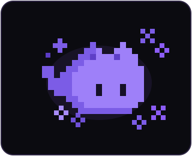

<!-- Top Navigation Bar -->
<table width="100%">
  <tr>
    <td align="left" valign="middle" width="32%">
      
    </td>
    <td align="right" valign="middle" width="68%">
      
      
      
      
      
      
      
    </td>
  </tr>
</table>

 

<!-- Hero / About Me Section -->
## About Me

<table>
  <tr>
    <td width="63%" valign="middle">
      <h3>Hi there 👋, I'm Juee Khandale</h3>
      

        
        
        
        
      

      

        I'm a Computer Science graduate focused on building production-oriented AI systems using <strong>Large Language Models (LLMs)</strong>, <strong>Agentic AI</strong>, and <strong>Retrieval-Augmented Generation (RAG)</strong>.
      

      

        Currently, I'm building an <strong>AI Research Analyst Agent</strong>—a modular Agentic RAG system that ingests enterprise documents, performs hybrid retrieval, and generates grounded responses through scalable AI workflows.
      

      <blockquote>
        💡 <em>"Build AI systems that are reliable, scalable, and engineered for real-world impact—not just demos."</em>
      </blockquote>
    </td>
    <td width="37%" align="center" valign="middle">
      
    </td>
  </tr>
</table>

 

<!-- Skills & Technologies (3-Column Card Layout) -->
## Skills & Technologies

<table width="100%">
  <tr>
    <td width="33%" valign="top">
      <h4>Languages &amp; Tools</h4>
      

        
        
        
        
        
        
      

    </td>
    <td width="34%" valign="top">
      <h4>AI &amp; LLM Orchestration</h4>
      

        
        
        
        
        
        
        
        
        
      

    </td>
    <td width="33%" valign="top">
      <h4>Retrieval &amp; Vector DBs</h4>
      

        
        
        
        
        
      

    </td>
  </tr>
</table>

 

<!-- Featured Projects (Timeline-Inspired Cards) -->
## Featured Projects

<table width="100%">
  <tr>
    <td width="10%" align="center" valign="middle">
      
    </td>
    <td width="90%" valign="top">
      <h4>🤖 <a href="https://github.com/Juee21/AI-Research-Analyst-Agent">AI Research Analyst Agent</a></h4>
      

        <code>LangGraph</code> · <code>LangChain</code> · <code>FastAPI</code> · <code>Google Gemini</code> · <code>ChromaDB / Qdrant</code>
      

      <ul>
        <li>A production-oriented Agentic RAG system designed for enterprise document intelligence.</li>
        <li>Features modular AI architectures, hierarchical document parsing (parent-child chunking), hybrid retrieval (BM25 + Cross-Encoder re-ranking), and automated evaluation pipelines.</li>
      </ul>
    </td>
  </tr>
  <tr>
    <td width="10%" align="center" valign="middle">
      
    </td>
    <td width="90%" valign="top">
      <h4>📊 <a href="https://github.com/Juee21/AI-Powered-Business-Analyst">AI Business Insights Assistant</a></h4>
      

        <code>Python</code> · <code>Google Gemini API</code> · <code>Plotly</code> · <code>Streamlit</code> · <code>FastAPI</code>
      

      <ul>
        <li>An intelligent analytics platform that ingests unstructured business documents, extracts key operational metrics, and renders dynamic interactive charts.</li>
      </ul>
    </td>
  </tr>
</table>

 

<!-- Current Focus & Learning (2-Column Cards + Career Focus Banner) -->
## Current Focus

<table width="100%">
  <tr>
    <td width="55%" valign="top">
      <h4>🚀 What I'm Working On</h4>
      <ul>
        <li>🤖 <strong>Building:</strong> An AI Research Analyst Agent</li>
        <li>🧠 <strong>Designing:</strong> Production-style Agentic RAG architectures</li>
        <li>🔍 <strong>Improving:</strong> Retrieval accuracy with Hybrid Search (BM25) &amp; Cross-Encoder Re-ranking</li>
        <li>⚙️ <strong>Developing:</strong> Scalable AI APIs using FastAPI</li>
        <li>📊 <strong>Evaluating:</strong> Pipelines for retrieval and generation quality checks</li>
      </ul>
    </td>
    <td width="45%" valign="top">
      <h4>📚 Currently Learning</h4>
      <ul>
        <li>Advanced Agentic AI Workflows</li>
        <li>LLM Evaluation Frameworks (Ragas / TruLens)</li>
        <li>AI System Design &amp; Infrastructure</li>
        <li>MLOps for LLM Applications</li>
      </ul>
    </td>
  </tr>
  <tr>
    <td colspan="2" align="center">
      <h4>🎯 Career Focus</h4>
      
I am actively seeking full-time opportunities as:

      

        
        
        
        
        
      

    </td>
  </tr>
</table>

 

<!-- GitHub Stats (Dark & Lavender Purple Theme) -->
## GitHub Stats

  
  
    
  

 

<!-- Let's Connect -->
## Let's Connect

  
  
  
  
  
  
    
  
⭐ <strong>Thanks for visiting! Feel free to check out my projects and connect with me!</strong>

